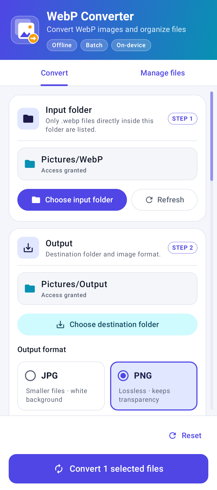
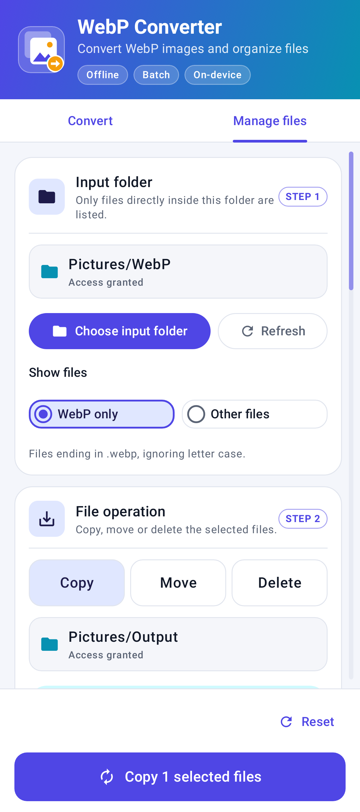
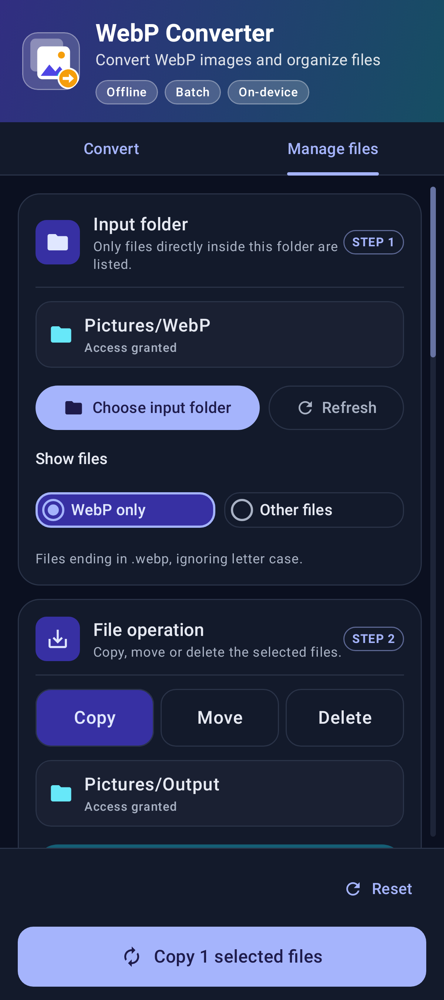
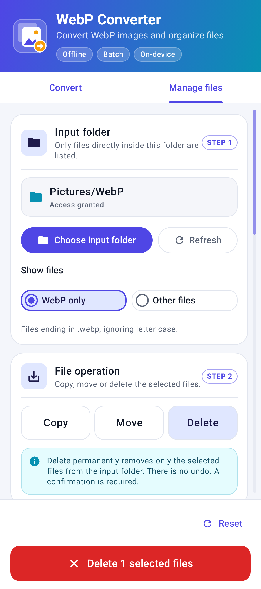

# WebP Converter for Android

A native, offline Kotlin/Jetpack Compose app for bulk converting WebP images to JPG/PNG and copying, moving or deleting selected WebP or non-WebP files.

## Installation for users

See the [end-user installation guide](INSTALLATION_GUIDE.md) and [User Manual](USER_MANUAL.md). The versioned APK to share with users is [WebP-Converter-v1.4.0-Android.apk](WebP-Converter-v1.4.0-Android.apk); the standard Gradle release output remains `app\build\outputs\apk\release\app-release.apk`. No public download site has been configured. Complete the device tests described below before distribution.

## Look and feel (v1.4.0)

| Convert | Manage files | Dark | Delete |
|---|---|---|---|
|  |  |  |  |

- Adaptive launcher icon (`res/drawable/ic_launcher_*.xml`), including a monochrome layer for Android 13+ themed icons and a dedicated notification icon.
- Material 3 theme with light and dark color schemes (`ui/Theme.kt`), a gradient header, numbered bordered panels, format cards, bordered file rows and a pinned bottom action bar with a progress panel.
- A custom draggable and tappable scrollbar for the file list (`ui/Scrollbar.kt`).
- **Reset** in either tab clears both tabs' folder fields, files, selections, results and errors, restores PNG/Copy/WebP-only defaults, and retains the active tab. Saved fields/report references are cleared too; interrupted scans and in-flight report loads cannot restore stale data. Reset is disabled while busy and does not modify files or revoke folder grants.
- The screenshots were rendered off-device with Robolectric. Check them on a real device as well.

## User workflow

1. Select the **Convert** tab, tap **Choose input folder** and grant access through Android's system folder picker.
2. The app scans **only that folder**, not subfolders, and lists `.webp` filenames (case-insensitive), sizes and checkboxes. Some document providers do not report a size; these show **Size unavailable**.
3. Select one image, several images, or **Select all**. The selected count updates immediately. Tap Select all again to clear the selection.
4. Choose a destination folder and select **PNG** or **JPG**.
5. Tap **Convert**. Progress shows the current file number and the number finished. Conversion continues in a foreground WorkManager worker when the screen closes.
6. On completion, read the success count and any individual errors. Full success is displayed only when every file succeeded. **Cancel conversion** stops the batch and keeps completed images.

Conversion never modifies originals or intentionally overwrites an existing destination file. Repeated names receive suffixes such as `photo (1).jpg`. Input and output may be the same folder for conversion.

### Manage files

- Switch to **Manage files** and choose **WebP only** or **Other files**. Other files means every non-`.webp` direct-child file, including extensionless files; directories and subfolders are excluded.
- The input and destination folders are shared with **Convert**. WebP selection is shared while the WebP filter is active. Changing category or switching from non-WebP management to conversion clears the selection; conversion always lists only WebP files.
- Choose **Copy**, **Move** or **Delete**; select any subset or **Select all**, then use the pinned action button.
- Copy/move require a different destination folder and preserve file bytes and embedded data. The source MIME type is used when available; provider metadata such as timestamps may differ. Existing names receive suffixes such as `photo (1).webp` or `report (1).pdf`; unsupported characters are sanitized and long names may be shortened.
- Move verifies the copied bytes using SHA-256 before source deletion. Durable checkpoints prevent a restarted move from deleting its only verified copy. A failed source deletion keeps the copy and reports the error.
- Move/delete require write access to the input folder; reselect folders granted read-only access by older versions.
- Move and delete require confirmation that identifies the active file category. **Delete is permanent, with no undo or recycle bin.** Only selected listed files are affected, never unselected files or subfolders.
- All operations use the existing single-batch WorkManager queue, foreground notification, per-file progress, cancellation and persistent reports. Controls are locked while busy. Move/delete refresh the source list on completion.
- Cancellation does not undo completed changes. A verified copy may remain after a cancelled move. Inspect both folders before retrying; do not modify files externally during a batch.

### Deliberate behavior

- Animated WebP conversion is **rejected with a per-file error**, never silently flattened. File-management operations do not decode images and support animated WebP.
- PNG retains alpha. JPG composites transparent and partially transparent pixels onto **white**, then encodes at JPEG quality **95**.
- Full image dimensions are retained; images exceeding the device-dependent safe decoding budget fail explicitly instead of being silently downsampled.
- Output is rendered in sRGB. Source EXIF/XMP/GPS/ICC metadata is not copied; Android's decoder applies supported orientation information.
- Processing is sequential to limit memory use. Progress advances between files, not within a single native codec operation.
- Persisted folder access and the management file category survive app restarts, unless reset or access is revoked. File selections are in-memory and reset after process recreation; running batch requests, source MIME types and results are persisted privately.
- Unsupported, corrupt, inaccessible and unwritable files are reported without preventing other files from being attempted.
- Android 11+ restricts selection of certain roots, `Android/data`, `Android/obb` and the Downloads root. Choose a permitted subfolder such as `Pictures/WebPInput` or `Download/WebPOutput`.
- Local device folders are recommended. Third-party/cloud document providers can be slow, unavailable, read-only, still loading, or have different naming semantics. If still loading, the app requests a refresh rather than presenting an incomplete list as complete.

## Open and build

See [DEVELOPMENT_PLAN.md](DEVELOPMENT_PLAN.md) for hardware, architecture, phased delivery, device acceptance tests and production signing.

For Google Play publication, signed AAB builds, update releases, key backups/recovery and migration to a new development PC, see the [Play Store Deployment Guide](PLAY_STORE_DEPLOYMENT_GUIDE.md).

Requirements: JDK 17, Android SDK Platform 36, Build Tools 35.0.0, internet for the initial dependency restore, and Android 9/API 28+ to run.

1. Open this folder in a compatible stable Android Studio.
2. Set the Gradle JDK to JDK 17; install SDK Platform 36 and Build Tools 35.0.0 through SDK Manager and accept their licenses.
3. Let Android Studio create `local.properties` with your SDK path. The file is machine-local and ignored by Git.
4. In PowerShell, with `JAVA_HOME` pointing at JDK 17:

```powershell
.\gradlew.bat testDebugUnitTest lintDebug assembleDebug assembleDebugAndroidTest
```

Or run the **Verify Android converter** VS Code build task / `.\scripts\verify.ps1`. This helper uses `JAVA_HOME`, or an optional machine-local `jdk.dir` in `local.properties`. Backslashes and the drive colon in property values must be escaped, for example `jdk.dir=C\:\\Java\\jdk-17`.

Outputs:

- Installable development APK: `app\build\outputs\apk\debug\app-debug.apk`
- Device-test APK: `app\build\outputs\apk\androidTest\debug\app-debug-androidTest.apk`
- Unit-test report: `app\build\reports\tests\testDebugUnitTest\index.html`
- Lint report: `app\build\reports\lint-results-debug.html`

On an attached device/emulator:

```powershell
.\gradlew.bat connectedDebugAndroidTest
adb install -r .\app\build\outputs\apk\debug\app-debug.apk
```

JVM tests cover both file filters, collision-safe naming for files with and without extensions, WebP container validation, copy/move/delete ordering, failure and cancellation safety, restart recovery, operation gating, actual byte-stream copying, MIME types and journal compatibility. Robolectric runs storage integration and rendered Compose UI tests, including tab selection and destructive-action confirmations. Screenshots are written to `app\build\previews`. Instrumentation tests exercise actual WebP-to-PNG/JPG encoding, pixel alpha/white compositing, file signatures, dimensions, originals preservation, selection and confirmations on Android.

**A debug APK is not a production release.** Release builds deliberately fail if all four signing environment variables are not configured. Do not distribute any test-signed release as production or lose the production signing key.

### Verification performed in this workspace

- Debug app and instrumentation-test APKs compiled successfully.
- All **56 JVM tests passed in each of the debug and release variants**, including file-filter selection, reset persistence, old-report suppression, busy-state and shared-tab UI tests, storage tests and end-to-end `ConversionWorker` copy/move/delete tests against a file-backed document provider.
- Debug and release lint passed with **0 errors**; dependency-version/KTX recommendations remain as warnings.
- The R8/resource-shrunk release packaged successfully and passed APK v2 signature verification and 16 KB ZIP alignment verification.
- Packaged graphics-path ELF LOAD segments have 16 KB alignment for all four bundled ABIs.
- The release-signing guard was tested and rejects missing signing credentials.
- **Production release APK:** `app\build\outputs\apk\release\app-release.apk`
  - Application ID `com.apps.multiformat.webpconverter`, versionCode 6 / versionName 1.4.0, minSdk 28, targetSdk 36.
  - Signed with the owner production key (PKCS12, RSA 3072, alias `webpconverter-release`, `CN=WebP Converter, O=Independent Developer, C=IN`), APK Signature Scheme v2.
  - Certificate SHA-256: `a50fee2af2e6b9ff1bd7bd28193f1dffa7eee42a63101c77a9b99c97a2816210`. This is the same key as previous releases. Version 1.4.0 can update 1.3.1, which uses the same application ID. Versions 1.0.0–1.3.0 used `com.kensteve4ever.webpconverter` and cannot be updated in place; their APKs are in `archive\com.kensteve4ever.webpconverter\`.
  - `WebP-Converter-v1.4.0-Android.apk` SHA-256: `50FC677316D436C51BCC817F84B8E67647D3CFAC4D2F93D080441B8F1F869D1A`.
  - The keystore lives outside the project in `%USERPROFILE%\.android-keystores\webpconverter\`. Move the password from `KEYSTORE-CREDENTIALS.txt` into a password manager, delete that file, and keep two encrypted offline backups of the `.p12`. If you lose it, you can't ship updates.
- No Android device is attached and hardware virtualization is unavailable on this host. Instrumentation pixel/UI tests were compiled, **not executed**. Before distributing the APK, run `connectedDebugAndroidTest` and the device checklist in DEVELOPMENT_PLAN.md §8 on a physical device.

## Project layout

```text
app/
  build.gradle.kts
  proguard-rules.pro
  src/
    main/
      AndroidManifest.xml
      java/com/example/webpconverter/
        MainActivity.kt
        ui/               # Compose screen, StateFlow ViewModel
        data/             # SAF queries, models, private atomic batch journal
        conversion/       # WebP validation, image codecs, foreground worker
      res/
    test/                 # JVM tests
    androidTest/          # Device pixel/codec and UI tests
gradle/wrapper/            # Pinned Gradle wrapper and distribution checksum
scripts/verify.ps1
```

## Operational limits

Android decides when queued work runs. A foreground worker is not an unlimited execution guarantee: Android 15+ applies data-sync foreground-service time limits, and Android 16 applies job quotas to WorkManager jobs. Force-stop prevents work until the app is opened again. Cancellation is cooperative around codec operations; a large encode may finish before the cancellation check.

Completed per-file results are atomically journaled. If Android stops and later reruns the same work, completed entries are skipped; a tracked unfinished output is removed before that entry is retried. There is no transaction spanning a document provider and private storage: process death between external document creation and journal persistence can leave an orphan/partial file. A provider refusing deletion is surfaced with the output URI for manual cleanup. Explicit cancellation is not automatically retried.

Batch requests/reports contain local filenames, URIs, MIME types and errors, not duplicate file data. They are retained in app-private storage until app data is cleared/uninstalled. Clearing app data removes reports and grants, **not** converted images in user folders. Choose smaller batches if platform quotas stop a very long operation.
