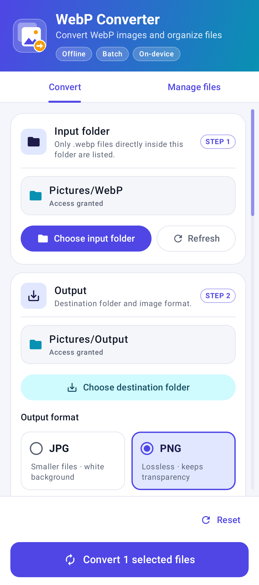

# WebP Converter — User Manual

**Version:** 1.1.0  
**For:** Android 9 and newer  
**Purpose:** Convert selected WebP images to PNG or JPG on your device.

For downloading and installing the app, see the [Installation Guide](INSTALLATION_GUIDE.md). The APK for this version is named **WebP-Converter-v1.1.0-Android.apk**.

## What the app does

WebP Converter scans a folder you choose, lets you select WebP images, and saves converted copies in a destination folder you choose. Conversion happens on your device; image contents are not uploaded. The app does not change or intentionally overwrite your originals or existing destination files.

## The screen at a glance

- **Header** – the app name and a short description at the top.
- **Panel 1 – Source folder** – choose the folder that contains your WebP images.
- **Panel 2 – Output** – choose PNG or JPG using the two format cards, and choose the destination folder.
- **Files list** – each WebP image appears as a bordered card with its name, size and checkbox. A selected card is highlighted. A scrollbar appears on the right while you scroll; drag it to move quickly through long lists, or tap the track to jump.
- **Bottom bar** – the **Convert** button always stays visible at the bottom. During a batch, it shows a progress panel with a **Cancel conversion** button.
- The app follows your phone's light or dark mode.

## Convert images

1. Open **WebP Converter**.
2. Tap **Choose input folder**.
3. In Android's folder picker, navigate to the folder containing your images. Select **Use this folder**, then confirm **Allow** if Android asks. The app displays WebP files directly in that folder.
4. Tap **Choose destination folder** and select where the converted copies should be saved. You can use the input folder itself, if desired.
5. Choose the output format:
   - **PNG** preserves transparent pixels and uses lossless compression.
   - **JPG** uses JPEG quality 95. Transparent and partly transparent pixels are composited onto white.
6. Select images from the list:
   - Tap an image row or checkbox to select or deselect that image.
   - Tap **Select all** to select all listed images. Tap it again to clear the selection.
   - The selected count (for example, **3 of 12 selected**) appears above the file list.
7. Tap **Convert _n_ selected files** in the bottom bar to start the batch.
8. Follow the progress shown in the app. It reports the current file and finished count. On Android 13 and newer, the app may request permission to show notifications; this permission is optional.
9. When conversion finishes, review the result summary. If any images failed, the app lists their errors. Open the destination folder in your file manager to inspect the converted files.

Conversion can continue while you leave the app. Android may delay or limit long-running background work. Keep the device charged and avoid force-stopping the app during a batch.

## Working with folders and files

- The input scan includes only files directly inside the selected folder; it does not search subfolders.
- If you add files after selecting the input folder, tap **Refresh** to scan again.
- File sizes appear when the storage provider reports them. **Size unavailable** means the provider did not supply a size.
- Android may prevent access to certain locations, including the Downloads root, `Android/data`, and `Android/obb`. Use an allowed subfolder such as `Pictures/WebPInput` or `Download/WebPOutput`.
- Local device folders are recommended. Cloud or third-party providers can be slower, unavailable, read-only, or have different file-naming behavior.
- If a destination already contains a file with the same name, the app keeps it and gives the new output a unique name, such as `photo (1).png`.
- The app does not copy source metadata such as camera details, GPS location, or other embedded metadata to converted images. Keep the originals if that information matters.

## Cancel a conversion

Tap **Cancel conversion** while the batch is active. Files that finished before cancellation are kept; files not yet converted are not guaranteed to be processed. An image currently being encoded may take a little time to stop.

## Supported files and expected results

- Static `.webp` images, with the extension matched without regard to letter case.
- Output is saved as `.png` or `.jpg`, according to your selected format.
- Image dimensions are retained. Extremely large images may fail if they exceed the device's safe decoding memory budget; the app does not silently resize them.
- Animated WebP is not supported. It is reported as a per-file failure rather than silently converted into a still image.
- Corrupt, inaccessible, unsupported, or unwritable files can fail individually. The app attempts to continue with the other selected images.
- PNG preserves transparency. JPG does not support transparency, so transparent areas appear white.

## Troubleshooting

| What you see | What to do |
|---|---|
| No files are listed | Confirm that the files end in `.webp` and are directly inside the selected folder. Tap **Refresh**. |
| The folder picker will not let you choose a location | Choose an ordinary subfolder instead of a restricted Android or Downloads root location. |
| **Convert** is unavailable | Select an input folder, an output folder, and at least one file. Wait for scanning or any active batch to finish. |
| A file reports an error | Check the filename shown with the error. Make sure the input is readable, the destination is writable and has free space, and the image is not animated or unusually large. |
| The batch is queued or progress is slow | Android controls background scheduling. Reopen the app to check status, keep the phone powered, or try a smaller batch. |
| An output appears to be missing | Check the selected destination folder. A duplicate filename may have a numbered suffix. Some providers or gallery apps take time to refresh. |
| A folder no longer works | Re-select it and grant access again. Access can be revoked by Android, the provider, or by clearing app data. |

If a batch stops or reports an error, the originals remain unchanged. Review the error details before retrying.

## Privacy and app data

The app converts files locally and does not upload image contents. It uses the folder permissions you grant through Android's system picker. It stores batch status and results privately so conversion progress can be restored. Clearing app data removes that status and the saved folder permissions, but does not normally delete converted files in shared folders.

## App information

- **App name:** WebP Converter
- **Version:** 1.1.0
- **Package ID:** `com.kensteve4ever.webpconverter`
- **Minimum Android version:** Android 9 (API 28)

This version has not yet been verified through on-device testing. Keep copies of important originals and check conversion results before relying on them.
