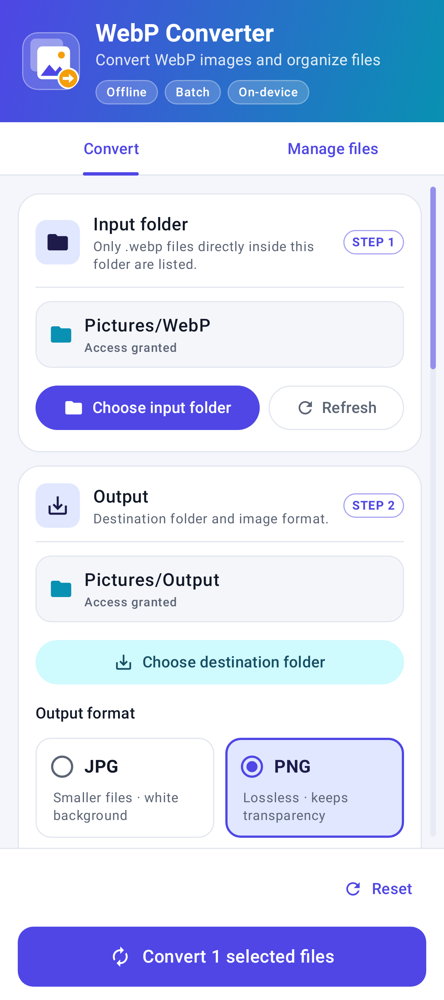
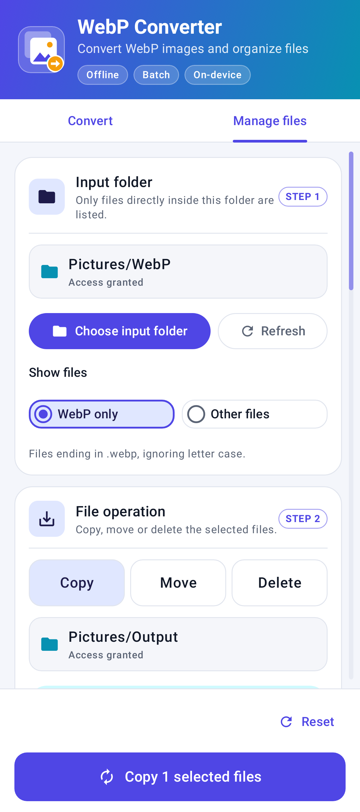
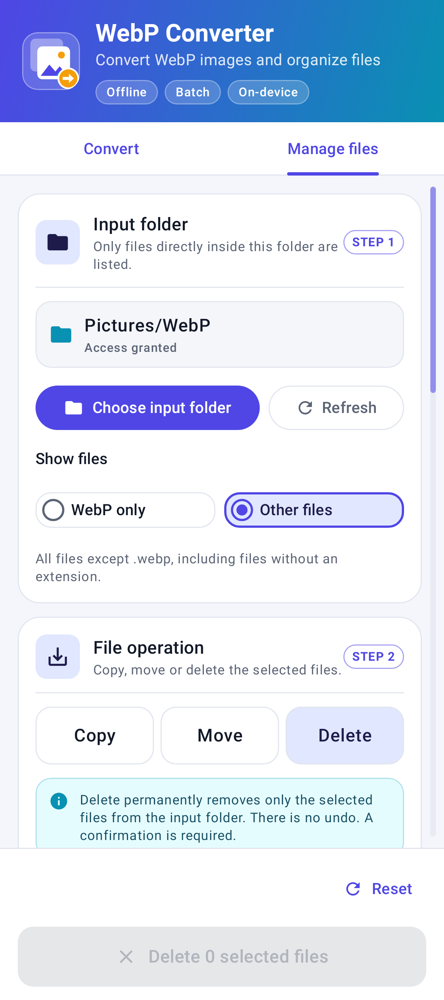

# WebP Converter — User Manual

**Version:** 1.4.0  
**For:** Android 9 and newer  
**Purpose:** Convert WebP images, or copy, move or delete selected files on your device.

For downloading and installing the app, see the [Installation Guide](INSTALLATION_GUIDE.md). The APK for this version is named **WebP-Converter-v1.4.0-Android.apk**.

## What the app does

WebP Converter scans a folder you choose. The **Convert** tab saves JPG or PNG copies of selected WebP images without changing the originals. The **Manage files** tab lets you select either WebP files or other file types to copy, move or permanently delete. Processing happens on your device; file contents are not uploaded. Existing destination files are not intentionally overwritten.

> **Important:** Other files can include documents, videos and files without extensions. Move removes source files after copying; delete permanently removes source files without making a copy. There is no undo. Back up important files first and do not edit the source or destination files during a batch.

## The screen at a glance

- **Header** – the app name and a short description at the top.
- **Tabs** – switch between **Convert** and **Manage files**. Input and destination folders are shared; WebP selections are shared when **WebP only** is selected. Switching to a different file category clears the selection. Tabs and configuration are locked while a batch is active.
- **Panel 1 – Source folder** – choose the input folder. On **Manage files**, choose **WebP only** or **Other files**.
- **Panel 2** – configure PNG/JPG and destination in **Convert**, or choose **Copy**, **Move** or **Delete** in **Manage files**.
- **Files list** – each matching file appears as a bordered card with its name, size and checkbox. A selected card is highlighted. A scrollbar appears on the right while you scroll; drag it to move quickly through long lists, or tap the track to jump.
- **Bottom bar** – the selected action and file count always stay visible. During a batch, it shows progress and **Cancel conversion** or **Cancel operation**.
- The app follows your phone's light or dark mode.

## Convert images

1. Open **WebP Converter** and select the **Convert** tab.
2. Tap **Choose input folder**.
3. In Android's folder picker, navigate to the folder containing your images. Select **Use this folder**, then confirm **Allow** if Android asks. The app displays WebP files directly in that folder.
4. Tap **Choose destination folder** and select where the converted copies should be saved. You can use the input folder itself, if desired.
5. Choose the output format:
   - **PNG** preserves transparent pixels and uses lossless compression.
   - **JPG** uses JPEG quality 95. Transparent and partly transparent pixels are composited onto white.
6. Select images from the list:
   - Tap an image row or checkbox to select or deselect that image.
   - Tap **Select all** to select all listed images. Tap it again to clear the selection.
   - The selected count (for example, **3 of 12 selected**) appears above the file list.
7. Tap **Convert _n_ selected files** in the bottom bar to start the batch.
8. Follow the progress shown in the app. It reports the current file and finished count. On Android 13 and newer, the app may request permission to show notifications; this permission is optional.
9. When conversion finishes, review the result summary. If any images failed, the app lists their errors. Open the destination folder in your file manager to inspect the converted files.

Conversion can continue while you leave the app. Android may delay or limit long-running background work. Keep the device charged and avoid force-stopping the app during a batch.

## Copy or move files

1. Open **Manage files**.
2. Tap **Choose input folder**, select the source folder and allow access. If you previously used an older app version, reselect the input folder to grant write access before moving or deleting files.
3. Under **Show files**, choose:
   - **WebP only** to show files whose names end in `.webp`, regardless of letter case.
   - **Other files** to show all other file types, including files with no extension. This excludes `.webp` files.
4. Choose **Copy** or **Move** in the **File operation** panel.
5. Tap **Choose destination folder** and select a different folder.
6. Scroll to the file list. Select individual rows/checkboxes, or use **Select all** for the currently displayed category. Tap **Select all** again to clear it.
7. Tap **Copy _n_ selected files** or **Move _n_ selected files** in the bottom bar. For move, check the source, destination, file category and count in the confirmation, then tap **Move files**. Tap **Cancel** to do nothing.
8. Watch the progress, review the result and any per-file errors, and check the destination in your file manager.

Changing the file category clears the selection. Switching to **Convert** from **Other files** also clears it and shows only WebP files. Switching between **Convert** and **Manage files** with **WebP only** retains the WebP selection. The chosen Manage files category is remembered until changed or reset.

**Copy** leaves the originals in place. **Move** first copies each file, checks the bytes using SHA-256, then deletes that source file. If copying or verification fails, its source is not deleted. If source deletion fails, the verified destination copy is kept and the error is reported; inspect both folders before retrying to avoid duplicate copies. The source list refreshes automatically after moving.

Both operations copy file contents unchanged, including embedded metadata and any WebP animation; they do not convert files. The app supplies the source MIME type when available, but provider-level metadata such as timestamps may differ. Existing destination names get a numbered suffix such as `photo (1).webp` or `report (1).pdf`. Names with unsupported characters may be sanitized and very long names may be shortened. Copying or moving into the same folder is not allowed.

## Delete some or all files

1. Open **Manage files**, choose the input folder, choose **WebP only** or **Other files**, and select **Delete**.
2. Select the files to remove, or tap **Select all** to select all files in the displayed category. Unselected files, files in the other category, and subfolders are not affected.
3. Tap **Delete _n_ selected files**. No destination folder is required.
4. Check the source folder, file category and count. Tap **Delete permanently** to proceed, or **Cancel** to keep everything.
5. Review the result and any errors. The file list refreshes automatically.

**Deletion is permanent. The app has no recycle bin or undo.**

## Working with folders and files

### Reset both tabs

Tap **Reset** in the bottom bar on either tab to start fresh. It clears the input and destination folders, file list, selections, previous results and error messages on **both tabs**. PNG, Copy and **WebP only** are restored as defaults; the current tab stays open. Cleared fields and previous results stay cleared when you reopen the app.

Reset does not delete or change any files, undo completed operations, or revoke Android folder permissions. It is disabled while an operation is queued/running or its status is being restored. Wait for the operation to finish, or cancel it and wait for it to stop, before resetting.

- The input scan includes only files directly inside the selected folder; it does not search subfolders.
- If you add files after selecting the input folder, tap **Refresh** to scan again.
- File sizes appear when the storage provider reports them. **Size unavailable** means the provider did not supply a size.
- Android may prevent access to certain locations, including the Downloads root, `Android/data`, and `Android/obb`. Use an allowed subfolder such as `Pictures/WebPInput` or `Download/WebPOutput`.
- Local device folders are recommended. Cloud or third-party providers can be slower, unavailable, read-only, or have different file-naming behavior.
- If a destination already contains a file with the same name, the app keeps it and gives the new output a unique name, such as `photo (1).png`.
- Conversion does not copy source metadata such as camera details, GPS location, or other embedded metadata to JPG/PNG images. Copy/move keep file bytes and embedded data unchanged, but storage-provider metadata may differ.

## Cancel a conversion

Tap **Cancel conversion** while the batch is active. Files that finished before cancellation are kept; files not yet converted are not guaranteed to be processed. An image currently being encoded may take a little time to stop.

For copy, move or delete, tap **Cancel operation**. Cancellation stops remaining work but does not roll back completed copies, moves or deletions. A verified copy may remain if cancellation occurs before its source is deleted; check both folders before retrying.

## Supported files and expected results

- Conversion accepts only static `.webp` images, with the extension matched without regard to letter case.
- **Manage files** supports WebP files or other direct-child files, including documents and extensionless files. Subfolders are not included.
- Output is saved as `.png` or `.jpg`, according to your selected format.
- Image dimensions are retained. Extremely large images may fail if they exceed the device's safe decoding memory budget; the app does not silently resize them.
- Animated WebP conversion is not supported. It is reported as a per-file failure rather than silently converted into a still image. Animated files can still be copied, moved or deleted.
- Corrupt, inaccessible, unsupported, or unwritable files can fail individually. The app attempts to continue with the other selected images.
- PNG preserves transparency. JPG does not support transparency, so transparent areas appear white.

## Troubleshooting

| What you see | What to do |
|---|---|
| No files are listed | Check the selected file category in **Manage files**, and confirm the files are directly inside the selected folder. **Convert** lists only `.webp` files. Tap **Refresh**. |
| The folder picker will not let you choose a location | Choose an ordinary subfolder instead of a restricted Android or Downloads root location. |
| **Convert** is unavailable | Select an input folder, an output folder, and at least one file. Wait for scanning or any active batch to finish. |
| A file reports an error | Check the filename shown with the error. Make sure the input is readable, the destination is writable and has free space, and the image is not animated or unusually large. |
| The batch is queued or progress is slow | Android controls background scheduling. Reopen the app to check status, keep the phone powered, or try a smaller batch. |
| An output appears to be missing | Check the selected destination folder. A duplicate filename may have a numbered suffix. Some providers or gallery apps take time to refresh. |
| A folder no longer works | Re-select it and grant access again. Access can be revoked by Android, the provider, or by clearing app data. |
| Move/delete needs write access | Reselect the input folder and allow access. A read-only folder can still be used for conversion or copying, but cannot be moved from or deleted from. |
| Copy/move reports the same folder | Select a different destination folder. Same-folder use is allowed only for conversion. |
| A move failed but a copy exists | Read the error; source deletion may have failed. Inspect both folders before retrying. Do not delete the destination copy unless you have checked that the source still exists. |

Conversion and copy leave the originals unchanged. Move and delete may already have removed some selected originals before a failure or cancellation. Review the per-file errors and both folders before retrying.

## Privacy and app data

The app processes files locally and does not upload file contents. It uses the folder permissions you grant through Android's system picker. It stores batch status and results privately so operation progress can be restored. Clearing app data removes that status and the saved folder permissions, but does not normally delete saved outputs in shared folders.

## App information

- **App name:** WebP Converter
- **Version:** 1.4.0
- **Package ID:** `com.apps.multiformat.webpconverter`
- **Minimum Android version:** Android 9 (API 28)

This version has not yet been verified through on-device testing. Keep copies of important originals and check conversion results before relying on them.
